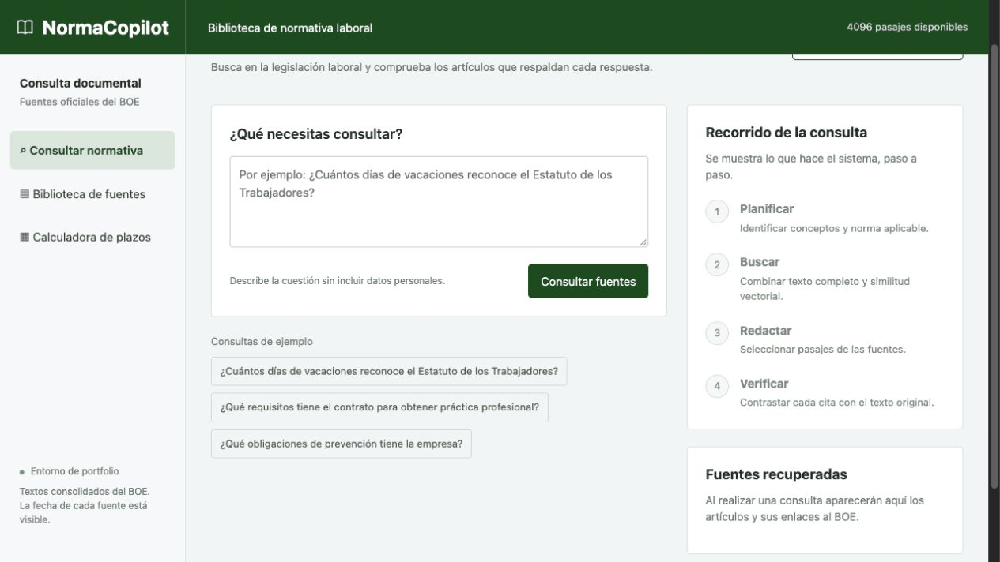
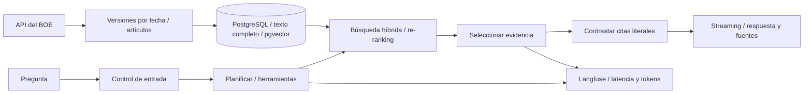

# NormaCopilot

[](https://github.com/PedroFlores199/NormaCopilot/actions/workflows/ci.yml)

**Consulta legislación laboral española y comprueba cada cita en el BOE.** Un grafo de LangGraph planifica la búsqueda, recupera artículos con PostgreSQL/pgvector, selecciona evidencia y descarta citas que no coincidan con el texto original.



| En un minuto | Qué puedes comprobar |
| --- | --- |
| Preguntar | Consulta en lenguaje natural y pasos del sistema en pantalla. |
| Verificar | Citas literales con artículo, norma, vigencia y enlace al BOE. |
| Buscar | Recuperación híbrida vectorial y texto completo, fusionada y reordenada. |
| Abstenerse | Si no queda evidencia contrastable, la respuesta indica que no lo sabe. |
| Calcular | Herramienta de calendario con días naturales/laborables y festivos explícitos. |
| Medir | 50 preguntas de referencia, 3 configuraciones y trazas locales de Langfuse. |

**Stack:** Python 3.12 · FastAPI · LangGraph · PostgreSQL/pgvector · Ollama o API compatible · Langfuse · Docker.

## Probarlo

```bash
git clone https://github.com/PedroFlores199/NormaCopilot.git
cd NormaCopilot
docker compose up --build -d
```

Abre [localhost:5101](http://localhost:5101). La primera ejecución descarga `qwen3:4b` y `nomic-embed-text` (unos 2,8 GB), indexa la captura del BOE incluida; puede tardar varios minutos. `GET /health` confirma la disponibilidad. El modelo local funciona sin clave de pago. Una consulta con CPU puede tardar varios minutos; la API permite hasta cinco minutos por generación. La captura mantiene su fecha de recuperación. La actualización consulta el BOE; las preguntas utilizan el corpus ya indexado.

En Apple Silicon, ejecutar Ollama nativo aprovecha Metal; el contenedor de Ollama utiliza CPU. Para el modo nativo: levanta solo `docker compose up -d postgres`, arranca Ollama en el puerto 11435, descarga ambos modelos y ejecuta `uv sync --extra test` y `uv run uvicorn app.main:app --port 5101`. `.env.example` recoge la configuración. No se incluyen secretos reales.

Para usar una API compatible: configura `LLM_PROVIDER=api`, `API_BASE`, `API_KEY` y `API_MODEL`. Los embeddings siguen ejecutándose con Ollama. El código valida respuestas estructuradas y mantiene el verificador con ambos proveedores. La medición incluida se ha realizado con Ollama; no se atribuyen resultados al proveedor remoto.

## Qué contiene



| Carpeta | Responsabilidad |
| --- | --- |
| `app/corpus.py` | API del BOE, selección de versión vigente, fragmentación y manifiestos. |
| `app/retrieval.py` | Texto completo español, búsqueda vectorial HNSW y fusión RRF. |
| `app/agents.py` | Grafo, selección de evidencia y verificación. |
| `app/models.py` | Modelos locales o API, JSON Schema y consumo de tokens. |
| `app/guardrails.py` | Patrones de datos personales, intentos de sobreescritura, citas y calendario. |
| `app/static` | Interfaz, streaming y enlaces de evidencia. |
| `evaluation` | Preguntas, referencias, resultados medidos y condiciones. |
| `observability` | Despliegue local de Langfuse, derivado del Compose oficial. |

El corpus incluye el Estatuto de los Trabajadores, Prevención de Riesgos Laborales y Ley General de la Seguridad Social: **4.096 pasajes en la captura validada**. Cada fragmento conserva su procedencia y fecha. `WEEKLY_UPDATES=true` programa una actualización los domingos a las 04:00, hora de Madrid; el servicio debe permanecer encendido.

## Resultados medidos

50 preguntas redactadas con artículo de referencia del Estatuto. Modelo `qwen3:4b`, conjunto y resultado completos incluidos.

| Configuración | Artículo recuperado @6 | Citas literales válidas | Respuesta con artículo esperado |
| --- | ---: | ---: | ---: |
| Híbrida | 90 % | 97,4 % | 84 % |
| Con re-ranking | 94 % | 98,8 % | 92 % |
| Con verificador | 94 % | 100 % | 92 % |

El 100 % significa que las citas publicadas coinciden con el pasaje recuperado. **No demuestra una interpretación jurídica perfecta.** Una de las 50 consultas quedó sin evidencia válida tras la verificación. No se ha presentado una comprobación literal como evaluación semántica RAGAS. [Informe y metodología](evaluation/REPORT.md).

16 pruebas verifican vigencia temporal, rechazo de citas inventadas, patrones de DNI/NIE/teléfono/correo, calendario, y búsqueda/reemplazo contra PostgreSQL real. `uv run pytest`; con base de datos disponible: `RUN_INTEGRATION=1 uv run pytest`. La CI incluye PostgreSQL/pgvector y construye la imagen. La consulta de vacaciones se ha probado contra el modelo local y devuelve el artículo 38.

## Observabilidad

```bash
docker compose -f observability/compose.yml up -d
```

Langfuse: [localhost:3100](http://localhost:3100), cuenta local `demo@norma.local` / `NormaDemo2026!`. Configura las claves de demostración `pk-lf-norma-local-demo` y `sk-lf-norma-local-demo` en la API. Si esta corre en Docker, usa `LANGFUSE_BASE_URL=http://host.docker.internal:3100`. Se han recibido eventos reales mediante OpenTelemetry. Las trazas guardan huella de la pregunta, tamaño, latencia y tokens; el texto de la consulta no se persiste en las trazas propias. El coste local se registra como cero de facturación de API y no incluye electricidad ni hardware. El proveedor remoto conserva el uso informado y su facturación depende de sus tarifas.

## Límites del sistema

La respuesta expone pasajes verificables y puede abstenerse; no resuelve por sí sola un caso jurídico. La consolidación del BOE es informativa y no tiene valor oficial. La selección por fecha no constituye un análisis completo de disposiciones transitorias o convenios no incluidos. El re-ranking es una combinación léxica y de posiciones, no un cross-encoder entrenado.

El filtro de datos personales se basa en patrones y puede no detectar nombres u otros datos sensibles. El rechazo de instrucciones maliciosas reduce casos comunes, pero no certifica inmunidad a prompt injection. Los servicios se publican solo en localhost y la concurrencia del modelo está limitada; un servicio público necesitaría autenticación, límites por usuario y una revisión adicional. [Fuentes y licencias](NOTICE.md).
